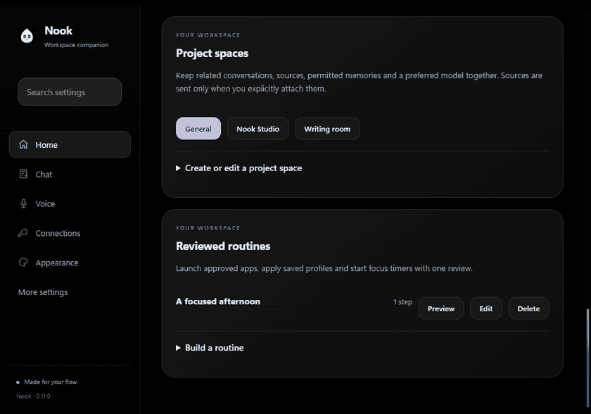
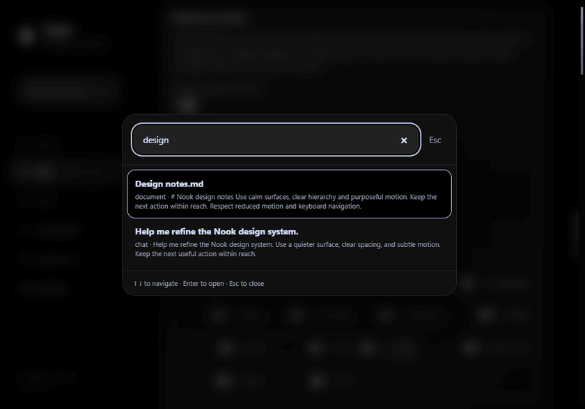
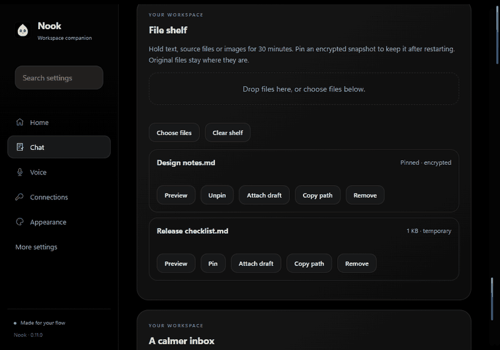
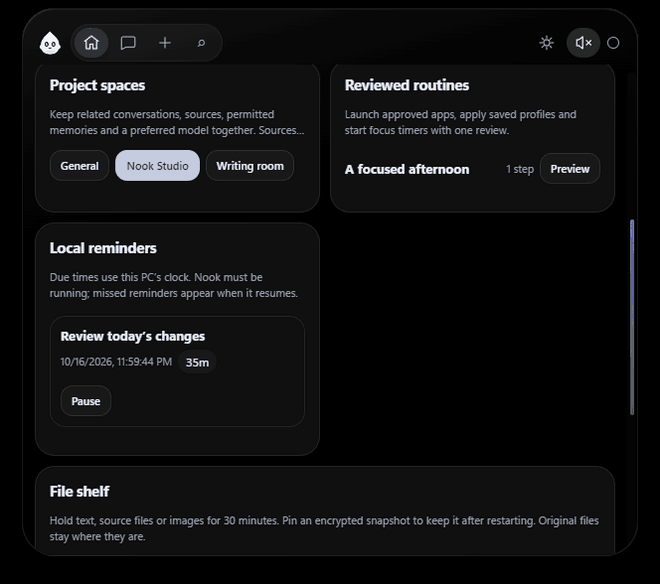
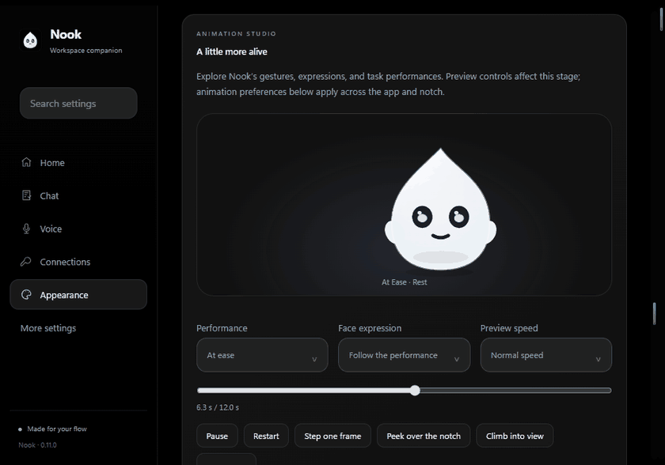
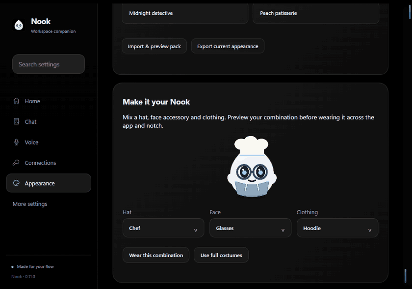

# Nook

A Windows desktop companion for coding agents, with a compact notch and multi-provider AI chat.

[Download Nook for Windows](https://github.com/hoeslovevid/Nook-Interactive-Assistant/releases/latest) · [Release notes](https://github.com/hoeslovevid/Nook-Interactive-Assistant/releases/tag/v0.11.2) · [Local AI setup](docs/NOOK-LOCAL.md)

## Projects and everyday tools

- **Search · Ctrl+K:** search saved chat text, imported documents and indexed project sources, approved memories, current agent sessions, project spaces, reminders and settings. Search stays on this PC; previews never send content to an AI. Only currently retained chats and explicitly imported/indexed sources are searched.
- **Home → Project spaces:** link conversations, documents, source projects and approved memories, with an optional preferred provider/model. Preview the switch first. Switching replaces active chat histories and clears temporary attachments, assistant context and prepared assistant actions. Within a space, only its selected approved memories can accompany future requests, still subject to each memory’s provider permissions. General restores its previous conversations. Previously transmitted messages cannot be recalled, and Nook Local’s separate local memory remains unchanged. Source links open local previews or Library; attaching content remains explicit. Spaces do not bypass chat retention or enable chat saving.
- **Home → Reviewed routines:** save up to six approved app launches, saved profiles and focus timers. Preview all steps, then run them in order. Changes to the routine or app approvals invalidate the preview. A failed step, lock or cancellation stops remaining steps; completed actions stay applied. Routines cannot execute arbitrary shell commands and do not run on a schedule.
- **Chat → Local reminders:** one-time, daily, weekday and weekly reminders, with pause, done and snooze controls. Times follow this PC’s local clock. Nook must be running; after sleep or restart, overdue occurrences are combined into one reminder. Native notifications obey global notification preferences and quiet hours. Reminders also appear in the hover notch.
- **Chat → A calmer inbox:** related updates group by linked source project or agent. Grouping limits repeated native notifications; snooze a group for 15 minutes, one hour or eight hours. Optional quiet digest waits for quiet hours and snoozes to end and rechecks notification preferences. Approvals retain their separate review controls.
- **Chat / hover notch → File shelf:** choose or drop up to twelve text, source, PNG or JPEG files (2 MB each, 12 MB shelf limit). Temporary snapshots expire after 30 minutes or closing Nook. Only explicitly pinned snapshots and their paths are stored, encrypted on this PC. Preview, copy a path, remove, or attach to a chat draft; nothing is sent automatically. Original files are never moved or deleted. Text snapshots use the existing 60,000-character attachment limit.
- **Appearance → Make it your Nook:** combine independent hats, face accessories and clothing. Full costumes and seasonal outfits remain available; choosing one returns to full-costume mode. The animation studio now includes parcel delivery, gentle reminders, a little conductor, blanket settling, sparkles and a morning stretch. New choreography uses anticipation, follow-through, flexible shapes and settling, with the existing reduced-motion, visibility and battery controls. These are original Nook drawings and animations inspired by Coucou’s attention to character, without copying its companion artwork or sounds.
- **Connections → Troubleshooting:** fixed, sanitized descriptions of recent model and voice failures, recovery links and a model-directory check. Review the exact redacted report before saving it. Reports exclude raw errors, prompts, keys, paths, file contents and account data; connection checks do not send chat messages.

Run `npm run smoke:hub` for isolated desktop checks and dark/light screenshots in `dist/hub-qa/`. App launches, cloud services, microphone input and native notifications use fixtures in automated checks; real-device validation remains in [DEVICE-TESTING.md](docs/DEVICE-TESTING.md).

See project spaces, search, reminders and the file shelf

### Switch projects with a review

Still images: [dark project dashboard](assets/previews/project-spaces.png) · [light project dashboard](assets/previews/project-spaces-light.png) · [local reminders](assets/previews/reminders.png).

### Find it locally

[View the search screenshot](assets/previews/unified-search.png) or [approved memory controls](assets/previews/memory-center.png).

### Keep files close

[View the file shelf screenshot](assets/previews/file-shelf.png). Previewing and attaching prepare a draft; neither sends it to an AI.

### Tools in the hover notch

Still images: [black notch tools](assets/previews/notch-tools.png) · [light notch tools](assets/previews/notch-tools-light.png).

## A more personal Nook

- **Everyday / All settings:** a saved view preference keeps detailed optional controls out of the everyday view. Settings search reveals advanced controls when needed. **Voice** starts with one guided path to the existing provider, microphone and voice controls.
- **Notch activity queue:** browse one useful update at a time in the hover dashboard. Pending approvals take priority; browsing stays stable while you hover or use the keyboard. Opening a card does not approve anything. Toggle the queue in Appearance.
- **Voice conversations:** assistant text appears as it streams. **Talk / interrupt** stops the current reply and starts the existing voice capture; **Stop reply** stops generation and speech. Optional **Start speaking before the reply finishes** queues sentences in order. Cloud speech can use more requests/credits in this mode. Only a fully parsed response can offer reviewed actions. Recognition still uses the configured speech engine and segmented capture; this is not a full-duplex cloud voice connection.
- **Chat → Memory you control:** explicitly add, edit, pause or forget up to twenty short facts. Memory is off by default, encrypted locally and shared only with the providers checked for that fact. It applies to future chat and conversational-assistant requests, not connection tests or document-processing tools. Nook never extracts memories automatically. Existing Nook Local memory remains separate and local-only.
- **Connections → Find the right model:** choose quick answers, coding, writing or images; optionally require local processing or set a maximum estimated reply cost. Recommendations use assigned roles, reported capabilities, recent measured response times and your entered prices. Unknown prices are excluded when a spending limit is set. Review and select a model; no request is sent automatically. These estimates do not impose a provider billing limit.
- **Appearance → Wardrobe:** twenty-nine costumes, a costume search, and curated companion collections. New costumes include a detective, chef, robot, pirate, bee, hiker, fox, dragon, vampire, graduate, knight and flower crown. Import/export a reviewed JSON pet pack with existing outfits and colors. Packs contain no executable artwork or remote URLs. The animation studio adds Little victory, Oops & recover, Coffee break, Peekaboo and Thank you bow. Existing motion, battery and visibility settings still apply.
- **Portfolio:** native balances on Bitcoin, Ethereum, Solana, Base and Arbitrum; explicitly selected ERC-20 contracts on the three EVM networks; read-only Kraken and Coinbase Advanced Trade accounts. Coinbase requires an ECDSA P-256 CDP key with View only; permissions are verified before reading paginated balances. Native/token values and prices are approximate. Duplicate wallets/contracts are refused. Public RPCs are rate limited and may be unavailable; failed sources produce partial data. No transfers, trading or automatic token discovery.
- **Performance:** an on-demand responsiveness check samples display frames only while visible. Its target is 95% within 35 ms and no more than three frames above 50 ms; results depend on the display and system load. Frame scheduling, disk-status caching and stable chat elements remain in place. Signed builds now require signing and verify both the installed executable and installer against the requested publisher. Trusted signing still requires owner-supplied certificate secrets; normal releases remain unsigned.

Run `npm run smoke:refined` for isolated desktop coverage and visual artifacts. Paid AI/speech/exchange services are simulated in this check. Source integration follows the official [Coinbase key-permissions API](https://docs.cdp.coinbase.com/api-reference/advanced-trade-api/rest-api/data-api/get-api-key-permissions), [Coinbase authentication](https://docs.cdp.coinbase.com/coinbase-app/authentication-authorization/api-key-authentication), [Arbitrum RPC documentation](https://docs.arbitrum.io/arbitrum-essentials/reference/node-providers), and [Ethereum read-only calls](https://geth.ethereum.org/docs/interacting-with-geth/rpc/ns-eth).

### A companion with character

[View the animation studio screenshot](assets/previews/pet-studio.png). Motion follows the app’s visibility, battery and reduced-motion settings.

Mix a hat, face accessory and clothing

Still images: [dark outfit controls](assets/previews/layered-outfits.png) · [light outfit controls](assets/previews/layered-outfits-light.png).

## More connections, voices and personal tools

- **Connections:** Qwen and Kimi/Moonshot have their own key cards and model browsers. Qwen supports the HTTPS endpoint supplied by your workspace console; Anthropic supports an optional company gateway using its native Messages API. Keys go to the displayed destination. Kimi defaults to `kimi-k2.6` with thinking disabled; newer thinking models preserve reasoning across follow-up turns and encrypted saved chats. Reasoning stays outside the visible transcript.
- **Voice → Cloud voice studio:** optionally save an ElevenLabs key, search your voices, preview, and choose separate chat/assistant voices. Speaking through ElevenLabs sends the spoken text to that service and can consume credits. It never silently switches engines after an error. Windows speech stays available locally. Temporary generated audio is removed after playback or cancellation.
- **Voice → Contacts:** add entries or preview a CSV/vCard import. Contacts are encrypted on this PC. Named recipients are matched locally after an email draft is accepted for review; choose the intended address explicitly. The full address book is never supplied to the model. Emails remain unsent reviewed drafts.
- **Voice → Approved applications:** discover installed Windows apps or choose a local executable and save a spoken name. Requests such as “Open Code” produce a one-use review before launch. Only approved apps are accepted, with no extra arguments or shell commands. Remove an approval to revoke it.
- **Voice → Dictation:** temporary paste now requests exclusion from Windows clipboard history and cloud sync by default, then restores the prior formats if the clipboard still contains the inserted text. Changed/protected targets are still refused. Third-party clipboard managers may handle exclusion flags differently.
- **Companion & devices → Portfolio:** explicitly enable manual holdings, public BTC/ETH/SOL wallet balances, or read-only Kraken balances. Kraken key permissions are checked before reading balances; trading, withdrawal and unknown permissions are refused. CoinGecko supplies prices and sparklines, with an optional Demo key. Unsupported tokens/fiat and missing prices are marked as partial data. This feature has no trading or transfer actions. Wallet addresses are sent to their public balance services; setup and keys are encrypted locally. The notch widget offers refresh and balance masking. Refreshes are deduplicated, rate limited, and stopped on lock/sleep; automatic refresh runs only when the widget is visible.

Chat streaming now updates the changed bubble while retaining completed replies. Visible pets share one frame scheduler per window, and unchanged local-model status reuses cached disk metadata. Wallet requests run at most four at once. Run `npm run smoke:expansion` for isolated UI checks; paid APIs and application launches use fixtures in this test.

## Sources, recovery and reviewed tools

Open **Library & tools** under **More settings**, from Chat, or from the **Sources** button in notch chat.

- Import PDF (20 MB, 100 pages), Word `.docx` (2,000 paragraphs), or UTF-8 text. Reading runs in a bounded worker with a timeout. Review individual page/paragraph excerpts before saving an encrypted local copy or attaching up to 60,000 characters to chat. Scanned PDFs require screenshot OCR; **Read screenshot** uses Windows OCR locally and requires an installed OCR language. Recognition may contain errors.
- Add an explicitly chosen project folder, review the included file list, and refresh manually. Each index is bounded to 160 small text files / 4 MB. `.gitignore` rules, generated folders, secret filenames, detected private keys/tokens and symbolic links are excluded. This is a convenience filter, not a guarantee that arbitrary source files contain no sensitive data; review excerpts before sharing. Local search matches words and returns up to eight labeled excerpts. Nothing is sent automatically, and the model should cite the provided source labels.
- Select text in another Windows app and press **Ctrl+Shift+Alt+S**, or paste it into Text actions. Supported apps expose text through Windows UI Automation without changing the clipboard. Review Summarize, Explain or Rewrite actions as chat drafts before sending. Protected fields are excluded; unsupported apps offer manual paste. Source actions preserve text already in the chat composer.
- Enable **Recovery** separately from saved conversation history. Unsent chat drafts, interrupted replies and unfinished voice text are stored in a small encrypted journal, separate from document indexes. Review, Restore or Discard each recovery; audio, files and keys are excluded. Up to one draft/reply per provider and one voice draft are retained. Turning recovery off deletes those drafts. Recovery is best-effort with a short debounce; the last second or two before a sudden crash may be missing.
- **Usage** shows local response latency, failures and provider-reported input/output token counts. Missing counts stay unknown. Up to 2,000 recent requests are retained, so the monthly view may be incomplete on heavy use. Optional editable USD prices produce estimates and a monthly alert; cache discounts, tiered pricing, audio/image charges and taxes are not calculated. Use provider billing for actual charges.
- Export/import versioned **theme packs** and **settings backups** with a preview and validation. Supported appearance, widget layout/sizes, model identifiers and notification choices transfer. Credentials, server addresses, chat/voice contents, dictionaries, application rules and project libraries are excluded. This is a portable preference subset, not a complete data backup.
- **Drafts** reviews email recipients, body and up to five explicit attachments (5 MB total) before saving an unsent `.eml` file. Calendar review shows the computer's time zone and exact start/end before saving `.ics` with UTC instants. Open the saved files in your mail/calendar app to send or confirm; Nook does not directly deliver messages or create remote events. A mail client that supports `.eml` drafts is required for editing/sending the email.
- Preview a **diagnostic report** before export. Its fixed allowlist excludes keys, server addresses, paths, prompts and transcripts. Nothing is uploaded automatically. Library reset removes local indexed copies, recoveries and usage; original documents stay in place.

**Voice additions:** double-tap the enabled dictation shortcut for hands-free recording, then press it again to stop. Drag the voice pill to move it or click Dock to return it to the bottom of the screen. Optional partial previews arrive in short local segments (not word-by-word streaming); processing speed depends on the engine and PC. Meeting notes retain segment timestamps and explicit bookmarks. Review and edit action-item lines before adding them as Nook tasks. Speaker identification remains manual.

**Pet animation:** task-specific typing bursts, reading pauses, thinking glances, listening nods, a greeting wink and expressive brows complement spring-based settling. Motion intensity, speed and personality still apply; hidden views stop drawing, economy mode caps frame rate, and reduced motion stays still.

Run `npm run smoke:library` for isolated desktop checks of document reading, real Windows OCR, source review, recovery, usage, reviewed file exports and partial dictation. New detailed tool copy currently falls back to English when no catalog translation exists.

## A focused workspace and Voice

The main navigation now groups everyday work into **Home**, **Chat**, **Voice**, **Connections**, and **Appearance**. Less frequent controls are under **More settings**. Search settings by name, follow the first-conversation checklist on Home, and find connection health beside your providers. Older Health & studio links open Connections. Layout editing lives in Appearance, voice controls in Voice, and phone pairing in Companion & devices.

Text fields and settings choices share rounded dark/light surfaces, clear focus states, and searchable choice dialogs. Choices support arrow keys, Home/End, Enter, Escape, and focus return. Existing native select values and change events are retained for settings compatibility. The notch adds clearer provider/capability information, task-model shortcuts, coordinated card transitions, draft preservation per provider, and retained chat scroll position when changing cards. Reduced motion remains supported.

**Voice → Dictation:** enable the global shortcut, hold **Ctrl+Shift+F8** (or F9/F10), speak, and release to review. Escape cancels while holding. **Ctrl+Shift+F11** inserts the previous dictation into the currently focused text field when the shortcut is available. Automatic insertion is separately opt-in and only targets the original window and focused control; protected or changed targets are refused. Clipboard text, HTML, RTF, and images are restored after insertion unless the clipboard changed. Custom clipboard formats require copying the draft manually. Dictation recording stops after 90 seconds. The local dictionary replaces whole phrases, and exact spoken snippets expand into saved text. Optional per-app AI cleanup sends only the current draft to the chosen connection, requires a manual request, can incur API charges, and can be undone. Dictation history is off by default; saved transcripts are encrypted on this PC. Local word/dictation counters contain no audio.

**Voice → Offline speech:** explicitly download the verified whisper.cpp v1.8.4 CPU runtime (about 4 MB) and Tiny English (78 MB) or multilingual Base (148 MB). Downloads use pinned SHA-256 hashes and a fixed model revision from GitHub/Hugging Face; audio stays local during recognition. Downloads can be cancelled and models removed. CPU performance varies by PC. Choose **Offline Whisper** for existing chat dictation under Companion & devices to use the same installed model. Windows speech remains available without a model download, provided the selected recognizer is installed.

**Voice → Meeting notes:** confirm participant awareness and consent, then record the microphone and optionally computer playback. A second confirmation is required for computer audio; no screen frames are retained. A floating recording indicator stays visible. Audio is transcribed in short segments, temporary files are deleted, and recording stops after 20 minutes or when processing cannot keep up. Review and explicitly save the encrypted transcript. It does not automatically identify speakers. Generating a summary sends the saved transcript to the selected AI connection only after confirmation; review and save that summary separately. Notes can be edited, exported as Markdown, or deleted.

Core new navigation, choice controls, voice labels, and consent dialogs are available in the ten supported interface languages. New terminology also reuses attributed MIT-licensed Coucou translations. Detailed new help and some diagnostics retain English fallback; translations still need native-speaker review. Android adds four widget variants and an optional stable signing workflow; owner-provided production signing keys/certificates and physical-device validation are still required. See [Android signing](android/README.md#widgets-and-stable-signing).

Run `npm run smoke:next` for isolated tests of custom choices, settings search, native hold-to-dictate shortcuts with synthetic audio, local dictionary handling, meeting consent, encrypted notes, and reviewed summaries. No real microphone or paid AI requests are used. Offline recognition has also been checked with whisper.cpp's public JFK sample on the actual downloaded CPU runtime.

## Connection studio and modern island

Open **Connections**, **Voice**, and **Appearance** for the latest controls. The default modern island uses a black outer shell, a minimal toolbar, rounded activity cards, a companion beside chat, pill-shaped approvals, and quieter chat options, inspired by [Coucou](https://github.com/Louis-CFM/coucou). Nook keeps its own original pet, artwork, and branding. **Classic Nook** remains selectable; dark and light themes both work.

See the [light theme](assets/previews/island-chat-light.png), [hover widgets](assets/previews/island-widgets.png), and [connection studio](assets/previews/connection-studio.png). These previews use sample conversations and synthetic audio.

- **Connection health:** choose a microphone and test its live level for up to 15 seconds. Tests stop when you leave the page or hide the app; no audio is saved or sent. Check installed speech languages and voices, preview speech output, inspect key-storage status, or send a small AI chat test. That test sends only “Reply with OK,” may incur API charges, and excludes chat history. A successful model-directory check alone does not prove chat access or available credits.
- **Models by task:** browse local/cloud providers, search models, and filter by reported image/tool support and context size. Unknown capabilities stay unknown. Assign coding, quick-answer, image, and fallback models. Fallback copies earlier text and a reviewable draft to a new target conversation without sending; the source and previous target remain in the library. Files/images are excluded, and a failed request containing an attachment requires reattaching it.
- **Chat actions:** supported requests offer a review card for focus timers, music playback, service views, and Spotify songs. Confirm to run; offers expire after two minutes and can be used once. Unknown phrasing can use **Chat options → Prepare an AI action**, which sends only the current draft to the selected AI for interpretation. The result must match a small allowlist; no arbitrary shell commands or agent approvals are offered.
- **Spotify song search/playback:** create a Spotify developer app, register `http://127.0.0.1:45823/callback`, enter its public Client ID, and connect. Sign-in uses PKCE; access and refresh tokens stay in Credential Manager. Choose the matching track before playback. A supported Spotify account, appropriate access, and an active playback device are required. Existing Windows media controls still work without Spotify sign-in.
- **“Hey Nook”:** opt-in local Windows recognition listens for this English phrase using the default Windows microphone and an installed recognizer. It interrupts spoken output and prepares a draft. Automatic sending is a separate opt-in; recognized text then goes to the selected AI, while actions still require review. A visible microphone badge can stop listening; the notch stays compact while the listener is active. The listener stops on lock/sleep/quit and can be stopped or restarted in the studio. Physical microphone and recognizer accuracy still require testing on your PC.
- **More expressive motion:** task changes include anticipation and settling, and attached files travel toward the companion. Existing breathing, gaze, blinks, task props, speech, outfits, and personality controls remain available. Reduced motion skips the new movement.
- **Visual layout editing:** drag or move widgets with keyboard controls, toggle visibility, choose small/wide cards, and see the live layout preview. Save width, horizontal position, and selected widget order for each display. Music/service widgets appear when connected, and waiting approvals take priority.
- **Automatic profiles:** associate saved profiles with foreground application process names or running-agent project paths. Matching runs only while enabled and waits during chat generation or approvals. Monitor following also runs only when enabled and avoids moving a focused notch.
- **Long conversations:** branch at a message, search the visible conversation, save encrypted per-provider instructions, and review AI-generated summaries before applying them. Summaries replace only the exact older turns actually summarized; originals remain in the library. Summary generation incurs the selected provider's API charges. Context counts are rough text estimates, exclude image costs, and use provider-reported limits when available. Clearing conversations also clears associated summaries; pinned provider instructions have their own controls.
- **Android companion:** [native Android source](android/README.md) adds certificate-pinned HTTPS pairing via a QR/link, Android Keystore storage, biometric approvals, questions, opt-in phone chat, session details, a home-screen widget, a Quick Settings tile, and an optional activity island. Android chat requires the encrypted connection and has separate temporary history; PC chat messages, attachments, and keys are excluded. The browser/iPhone HTTP connection remains for trusted Wi-Fi. Release signing and real-device validation remain owner setup tasks.

Run `npm run smoke:studio` for isolated UI checks using fake AI replies, credentials, speech, and Chromium's synthetic microphone. It also checks encrypted phone pairing in Electron. The Android source has been compiled with Android 35 resources and D8, and a locally signed debug APK is available under `dist/Nook-Android-debug.apk` for device testing. The Android workflow builds a debug APK and runs lint when pushed; production signing is not configured. Core studio labels are localized; detailed help retains English fallback.

## Conversations and everyday tools

Open **Chats & everyday tools** in the app, or use **Ctrl+K** to find a tool.

- Hover the notch for your selected focus, task, notification, agent, music, service, and prompt widgets. Services needing attention can appear first; pinned services follow. Music and service widgets appear when connected. Approvals take priority, with a picker when several requests are waiting.
- Keep named, searchable, pinned conversations and export them as Markdown. Chat saving is off by default; enabling it requires system encryption. Choose 7, 30, or 90 days of retention. Files, images, API keys, and server credentials are excluded. The library keeps up to 100 conversations and 200 messages per conversation within an 8 MB storage budget. Requests use recent messages within a bounded text budget, with reviewed summaries carrying older context. Reattach files after restarting or when the shared memory cache expires.
- Expand chat into a resizable window and return to the notch with the same conversation. Attach up to six text/source files or PNG/JPEG images, preview their included content, and remove them individually. File imports are limited to 2 MB and 60,000 text characters per file, with 120,000 characters of combined text. Token counts are rough text estimates; image usage varies by provider.
- Save personal prompts or use starters, then review the draft before sending. Compare two provider/model pairs side by side: the review names both destinations, and clicking Send makes two requests with only the comparison prompt. Comparisons support Stop and preserve partial replies.
- Use a focus timer with pause, resume, a five-minute break, and a small task list. Timer deadlines survive sleep and restart. Notification history contains bounded completion/service titles; approvals stay in their own review queue.
- Choose calm, playful, or focused pet behavior, animation intensity, speed, and movement within the pet area. Reduced motion remains available.
- Save notch width, horizontal placement, and widget selection per display. Missing monitors fall back to your existing monitor preference. Windows can hide the notch over fullscreen applications; the monitor watcher runs only while enabled. Pause hides the notch until opened from the tray or resumed in settings.
- In notch chat, choose **Commands** beside Hold to talk. Review the recognized command and click **Run command**. Supported commands open chat, requests, notifications, or tasks; start/pause/resume/stop a focus timer; and mute/unmute sounds. Commands cannot approve requests or send chat messages. Transcription follows your existing Windows/OpenAI voice setting.

## See Nook in motion

Real app recordings with local sample data—no API key needed for the walkthrough.

The compact task animation is shown at the top of this page. The recordings below were refreshed for the **0.11 series**; newer project tools and pet performances appear beside their feature descriptions above.

Explore the full app gallery: tasks, approvals, chat, themes and settings

### Task workbench

### Approvals and questions

### Chat

### Wardrobe and app settings

### Choose your theme

### Usage limits at a glance

### Continue a conversation with another AI

### Connected service companions

### Sound studio and custom agents

These clips show the real Nook interface using isolated sample sessions and simulated provider/service data. Usage, service balances, and failures are examples; no real API credentials or personal account data are used in the recordings.

Prefer still images? See the [welcome screen](assets/previews/welcome.png), [model connections](assets/previews/models.png), and [phone session details](assets/previews/phone-details.png).

New in 0.11: [Nook Local setup](assets/previews/nook-local.png), [guided voice setup](assets/previews/guided-voice.png), [project spaces](assets/previews/project-spaces.png), [reminders](assets/previews/reminders.png), and [layered outfits](assets/previews/layered-outfits-light.png). Phone images illustrate the existing companion; the desktop images and animated gallery were recaptured for this release.

The latest source UI has a compact toolbar, animated task companion, line-numbered changes, queue-aware approvals, and a quieter chat composer. See the [task workbench](assets/previews/notch-workbench.png), [approval card](assets/previews/notch-approval.png), and [chat view](assets/previews/notch-chat.png). The app includes a live workspace status strip and consistent navigation icons. These screenshots use isolated sample sessions.

Run `npm run smoke:workspace` on Windows to check session selection, typed-only questions, approval queues, unsaved preferences, narrow layouts, appearance persistence, notch sizing, hidden/reduced animation, key setup, searchable model selection, transcript preservation, history, phone revocation, and recap export without changing your real app data or sending real service actions.

Run `npm run smoke:chat` to verify actual keyboard entry and streamed replies through a local HTTP test server, plus dictation with Chromium's synthetic microphone. It checks microphone startup, cancellation, permission errors, failed audio setup, resource cleanup, and the expanded chat window without recording your microphone or using API credentials. In chat, choose your microphone from the input selector and use **Refresh** after connecting a headset. Windows must allow microphone access for desktop apps. Dictation creates a draft for you to review and send.

## Install on Windows

Download the latest **Nook-Setup-…-x64.exe** from [GitHub Releases](https://github.com/hoeslovevid/Nook-Interactive-Assistant/releases/latest). Run the setup wizard to choose an install location and create shortcuts. Supports Windows 10 and 11 on 64-bit Intel/AMD PCs. No Node.js installation is needed.

Nook is currently unsigned, so Windows may show a SmartScreen or unknown-publisher warning. Download only from this repository's releases. Verify a download against the included SHA256SUMS.txt with `Get-FileHash` if needed.

This repository is public. From version 0.5.1, downloading releases and checking for updates do not require a GitHub account or token. Nook checks stable releases at startup and every six hours. Open **Updates** in settings, or choose **Check for updates** from the tray. Download the update, then choose **Restart and install** when ready. Downloads are verified against SHA-512 release metadata; settings and provider keys are retained. Saved update tokens remain optional and encrypted locally; remove one under **Optional GitHub access** if it is expired. Automatic checks can be turned off. Nook never downloads or restarts silently.

Versions 0.2.1–0.5.0 used authenticated update checks. Those installations can use a valid saved token to download this release, or install it once manually to get updates without a token.

Versions 0.1.0 and 0.2.0 need a one-time manual upgrade using the latest installer. Manual installation remains available for any version: quit Nook through its tray menu, then run the newer installer. Uninstall from Windows Settings → Apps; saved settings are kept.

## Run from source

Install dependencies with npm install, then run npm start. Run npm test for the test suite.

To refresh the documentation media on Windows, run Electron with `scripts/capture-previews.cjs`, then `npm run previews:release`. Encode the recorded frames with `python scripts/encode-previews.py` and `python scripts/encode-previews.py --release` (Pillow required). Both recorders use isolated profiles and simulated services; files under `dist/` are excluded from Git and the installer. Review the generated media before publishing it.

## Appearance and performance

Preview the default [black app](assets/previews/black-theme.png) and [black notch](assets/previews/black-notch.png), the [appearance controls](assets/previews/customization.png) and [guided model setup](assets/previews/model-setup.png). These screenshots use isolated sample data.

**Appearance** offers four dark themes—Black (default), Graphite, Midnight, and Forest—and three light themes: Pearl (cool white), Sand (warm cream), and Mint (soft green). Selecting a theme applies matching app and notch colors; fine-tune the notch colors afterward. Your theme and custom colors are saved between launches. Comfortable or compact spacing, a 520–820 px expanded notch width (clamped to your display), and corner controls are also available. Animation modes apply to the app, notch, and desktop companion: Full uses adaptive companion drawing up to 60 fps when active, Economy at 15 fps, and Reduced draws still poses when they change. Windows reduced motion always takes priority.

Hidden and offscreen companion previews stop drawing. Unchanged chat transcripts and provider choices retain their existing interface elements; pointer tracking stops after the gaze settles. Each provider retains up to 200 recent chat messages in memory. Activity recaps reuse unchanged history and refresh the rolling week at least every minute, using at most the last 2,000 log lines within a 4 MB tail to keep lifetime log growth from blocking the interface.

## Build and publish installers

The Nook logo uses the original notch companion: a pale seed silhouette, periwinkle pupils, and a small smile on a black tile. Editable vector sources live in `assets/logo.svg`, `assets/icon.svg`, and `assets/tray.svg`. Run `npm run brand` on Windows to regenerate the application and installer icons, high-DPI tray images, phone home-screen icon, and installer sidebar from those sources. The animated companion remains the activity character.

Use Node.js 22 or newer, run `npm ci`, then `npm run dist` on Windows. The installer appears in `dist/`. `npm run pack` creates the unpacked app for testing. Run `npm run smoke:packaged` on a Windows desktop with Nook closed to verify packaged pages, native media, and agent hooks with isolated app data. Runtime files are explicitly included; tests, previews, and development dependencies are excluded. Native scripts and agent hooks are kept outside an ASAR archive so Windows can execute them. Installed agent hooks use Nook's bundled runtime.

For a release, update the version in package.json and package-lock.json, update `.github/RELEASE_NOTES.md`, commit, and push a matching tag such as `v0.2.0`. The Windows release workflow runs tests, builds and verifies the installer and update metadata, then publishes the installer, block map, `latest.yml`, and SHA-256 checksums together. A manual workflow run produces a downloadable build artifact without publishing a release. Releases currently use unsigned executables; code signing is not configured. The updater uses this public GitHub repository over HTTPS with optional locally saved authentication and SHA-512 artifact checksums; Authenticode verification is disabled until signed installers are available.

To refresh all thirteen animated previews, run `npx electron scripts/capture-previews.cjs`, then `python scripts/encode-previews.py` with Pillow installed. The recorder uses isolated sample data and writes frames under `dist/`; only the resulting GIFs are committed and they are excluded from the installer.

## Connect models

Open **Models & connections**, expand a provider, and choose **Get an API key** to open its key page. Paste the key (Show/Hide is available), then Save. Nook encrypts it locally and checks the provider's model directory, with clear feedback for missing keys, denied access, rate limits, and offline local servers. Connection checks do not generate a chat response or check your available credits.

Search the returned chat models and select one, or enter a model ID manually. Known embedding, speech-only, image-generation, reranking, and other non-chat entries are excluded where the provider identifies them. Discovery does not guarantee a listed model supports every chat feature or attachment type. Switch providers in notch chat, then choose **Switch model…** to select a different model without opening settings. Successful lists are cached for one minute; the settings check button refreshes them. API keys stay in the main process and are not returned to the interface.

Model discovery follows the providers' APIs, including [OpenAI's model list](https://developers.openai.com/api/reference/resources/models/methods/list), so users can choose models available to their account without waiting for a Nook release.

Supported connections: OpenAI, Gemini, Claude, OpenRouter, DeepSeek, Mistral, Groq, Grok, Ollama, LM Studio, and a custom OpenAI-compatible endpoint. OpenRouter provides access to additional model families with one key. API access requires the provider's API credentials; chat website subscriptions do not configure API access.

Chat errors distinguish known API credit, spending/usage-limit, key, model-access, and temporary rate-limit failures. OpenAI account errors include links to the relevant API billing or limit settings. A bare 429 without provider details remains ambiguous. When the server specifies a retry delay, Nook shows a countdown and prevents early requests to that provider; other providers stay available. There are no automatic chat retries, and provider error messages that might echo prompts or credentials are excluded from diagnostics.

Ollama and LM Studio connect to a running server on this PC without a key. Custom endpoints accept HTTPS remote servers or loopback HTTP, with an optional encrypted API key. Enter the full chat/completions endpoint URL.

## Chat formatting and continuing with another AI

Notch chat renders headings, emphasis, inline code, nested lists, quotes, and fenced code with a copy button. Links open only after a click and accept HTTP or HTTPS. Model output is rendered as text and safe interface elements; embedded HTML cannot run scripts.

Choose **Continue with another AI**, pick a destination and select the messages to copy. This replaces that provider's in-memory conversation while preserving the source. Files and images are excluded. Nothing is sent to the destination until you submit your next message. **Restore previous chat** remains available until you send a new message there. A handoff accepts up to 24 messages and 64,000 characters; larger selections are rejected instead of silently shortened.

Connected GitHub, Vercel, Stripe, Resend, Notion, n8n, and Cal.com cards have small animated companions with distinct colors and status expressions. Click one to open its details. Existing confirmation-based actions remain available for GitHub CI, Vercel previews, and n8n; the other service details are read-only. Cards retain their canvases between status updates and release their animation listeners when removed.

## Sound studio

In **Companion & devices**, preview greeting, approval, completion, chat-error, and pet-interaction sounds. Import WAV, MP3, OGG, or M4A recordings under 2 MB, adjust volume, and enable events individually. **Use default** restores a built-in tone and **Stop preview** stops playback. Custom sounds are local, limited to 15 seconds per playback, and master mute stops active audio. Older hi.wav, greet.wav, approval.wav, and finish.wav files are recognized.

## Languages

The default follows the Windows language, falling back to English when unsupported. Select English, Simplified Chinese, Hindi, Spanish, Arabic, French, Bengali, Brazilian Portuguese, Russian, or Indonesian in settings. App controls, help, onboarding, tray menus, dialogs, and common errors update with the selected language. Arabic uses right-to-left reading; code, URLs, keys, model identifiers, and user-authored content retain their direction and original text. Provider-supplied diagnostics and content may remain in their original language.

Translations are compiled from the editable files in locales/ with python scripts/build-locales.py. Some common translations are adapted from [Coucou](https://github.com/Louis-CFM/coucou), copyright 2026 Louis Raillé, under its MIT license. The attribution and license are distributed in lib/Coucou-Translation-LICENSE.txt. Nook's additional interface translations, artwork, and animations are maintained here.

## Secure keys and exact terminal navigation

Provider, integration, update-access, and push-relay keys use Windows Credential Manager. On first startup, Nook migrates the previous encrypted key file, verifies each migrated value, and keeps an encrypted recovery copy. Existing native entries take priority. A failed migration preserves the old encrypted file; the settings page reports storage status without exposing keys. Credential entries are scoped to the local Nook profile.

For precise VS Code or Cursor terminal selection, open **Agents → Linked terminals → Show terminal helper**. Install terminal-helper.vsix through the editor's **Extensions → Install from VSIX**, then run **Nook: Create linked terminal** and start the agent inside it. The helper restores that specific terminal, including split terminals, through an authenticated local pipe; it cannot type or execute commands.

Alternatively, use **Open linked Windows Terminal** to create a named tab. Keep its Nook title so Nook can select it again. Windows Terminal navigation restores the tab, rather than a particular split pane. Existing unlinked sessions use window or project-folder fallback. The helper source is in terminal-helper/; regenerate the bundled extension with python scripts/build-terminal-helper.py.

## Appearance

Appearance offers live color and corner controls. Reset look restores the default Black theme and periwinkle accent. Existing saved colors are preserved until you choose a new theme or reset the look. Keyboard focus and reduced-motion settings are supported.

## Companion & motion

Nook has eight expressive poses, shared across the notch, settings preview, and desktop companion. Preview every pose in Appearance. It reacts to active sessions, approvals, chat requests, completions, and dropped files.

The notch expands with a spring transition and coordinated content reveal. Buttons respond to presses; selected sessions and attached files get subtle feedback. Drop a file from Explorer onto the notch to attach it to chat. The companion notices the file, catches it, and celebrates once attached.

Windows reduced-motion preferences disable spring resizing, character hops, breathing, and interface transitions. Character expressions still communicate status. Artwork and animation are original to Nook.

## Task animations and settings

Reading, editing, and terminal tools now drive distinct looping companion animations with book, keyboard, and terminal cues. The 120-pixel desktop pet shares the notch's task state, including chat activity. Reduced motion keeps the expressions and task cues without movement.

Models & connections uses expandable cards, cloud/local/integration filters, saved-key filtering, search, and a selectable list of discovered models. Shortcuts display keycaps, record on click, reject duplicate or unsafe typing combinations, and restore previous shortcuts if Windows cannot register a change. The settings and notch use rounded accent scrollbars with hover and drag feedback.

## Wardrobe, voice, music, and pocket companion

Open **Companion & devices** to choose an original outfit, enable seasonal changes, configure dictation, and turn on Windows media controls. Outfits apply to the notch and desktop pet. Clicking the pet makes it react; repeated pokes briefly annoy it or make it dizzy before it recovers. Music makes it dance when no agent needs attention.

Music uses the active Windows media session. Spotify, browser playback, and other compatible players expose title, artist, artwork, playback controls, and seeking according to their Windows integration. Enable music controls first; controls appear in the notch activity card when a session is available. Unsupported controls are disabled. No Spotify account tokens are required.

In chat, **Dictate** starts the microphone only after you click. Stop to transcribe and review the draft; Esc cancels. Recordings stop after 45 seconds. Windows mode uses an installed offline Windows speech recognizer; choose a speech language in Windows if none is available. OpenAI mode sends the stopped recording to the OpenAI transcription API using your encrypted OpenAI API key and may incur API charges. Temporary local WAV files are deleted after transcription. Dictation never sends a chat message automatically.

**Window context** lists open windows. Choose one to capture a single screenshot, review it in chat, and send a question to a model with image support. Remove the screenshot to cancel. Nook does not continuously watch or capture your windows. Screenshots are held in memory and shared only when you send the message.

For the **phone companion**, click Enable phone access. Open the displayed address on a phone on the same trusted local network and enter the six-digit pairing code. The code expires after 10 minutes; paired browser sessions expire after 24 hours. You can view sessions, recent activity, approve or deny requests, and answer agent questions. Revoke & new code invalidates all paired devices. Disable closes the listener. Windows may require private-network firewall access; guest Wi-Fi or client isolation can prevent access. No firewall or router rules are modified by Nook.

The included phone companion works in a local browser. Keep its page open to receive updates. Local access uses HTTP, so use trusted Wi-Fi. API keys, chat messages, and attachments are excluded from the phone API. Its listener uses port 45821 and stays off until enabled; optionally select **Start phone access with Nook** to keep the address stable across restarts. The separate [native iPhone source](ios/README.md) adds Keychain pairing, device authentication, widgets, and Live Activity support; Apple signing and the optional [push relay](push-relay/README.md) require owner configuration.

## Quick interactions and guided setup

On first launch, a seven-step walkthrough introduces sessions, diffs, sample approvals and questions, offline chat, and service cards. Replay it with **Agents → Play demo**. Sample sessions are isolated from real state and do not write agent hooks, keys, or history. Ending the walkthrough restores the real view; a real approval interrupts it immediately.

Right-click the notch pet or desktop pet for chat, wardrobe, seasonal outfits, mute, and companion settings. Double-click the desktop pet to send it home, or drop it back at the top-center of a screen. Hold the pointer over the pet for a friendly heart reaction. Sleeping and hidden companions render less frequently. Agent colors in settings now tint the companion as well as session pills; a pending approval takes priority over the selected session.

Drag the desktop pet onto a visible window and release to attach a single screenshot to chat. Review or remove it before sending. The pet stays where you place it; release onto an empty desktop to move it without attaching context. Minimized, unavailable, and Nook windows are excluded. Multi-monitor coordinates are converted for Windows display scaling.

Music controls now expose **Shuffle** and **Repeat** when the active player supports them. Repeat cycles off → all → one; unsupported controls remain disabled.

## Phone details and follow-up drafts

In **Companion & devices**, enable **Share session details** to let paired phones inspect the latest 30 steps, bounded code diffs, and completed answers. This intentionally shares code and command context over your trusted local network; it is off by default. Session details are held in memory, not saved as a new history database. The phone also shows connected service summaries and has a focus filter for approvals and questions.

Enable **Receive follow-up drafts** separately to prepare the next instruction from a phone session. Drafts appear in the PC's **Phone draft inbox**, with **Copy draft**, **Copy & open terminal**, and **Dismiss**. Review and paste the instruction into the agent yourself; Nook does not inject keystrokes, resume an agent, or execute these drafts. The inbox holds up to eight drafts and clears when Nook quits. Disabling sharing takes effect on the phone's next refresh; revoking devices invalidates their tokens immediately.

## Workspace, history, and alerts

**Workspace & alerts** adds notification controls, quiet hours that can cross midnight, and per-agent muting. Windows notifications open the waiting request, completed session, or GitHub details. Quiet hours also silence the notch's sounds. Live approvals remain visible regardless of notification settings. The desktop pet docks at the notch when an approval arrives and returns to its saved spot only when the full queue is resolved; disconnected requests are removed without deciding for the agent. Disable pet travel independently.

The wardrobe includes a crown, bow, and raincoat alongside the existing outfits. Head movement carries glasses and hats, scarf tails settle with spring motion, and outfit changes fade. Reduced motion keeps outfits stable.

Enable **Keep completed sessions and decisions** to record an encrypted local archive. Search by text, agent, and project, inspect completed answers and diffs, or delete entries. Retention choices are 7, 30, and 90 days, with at most 300 entries and an 8 MB plaintext capacity before encryption. Recording is off by default; turning it off leaves existing history until it expires or you clear it. No chat attachments or provider keys are serialized. Shared code and command text can still contain sensitive information; enable history and phone detail sharing only for projects you intend to retain or share. The native phone can search the archive only when session detail sharing is enabled.

GitHub, Vercel, and n8n pills open detailed service views. Optionally enable service actions to retry failed GitHub jobs, redeploy Vercel as a preview, or activate/pause n8n workflows. Your service token needs the relevant write permissions. Actions are offered for recent fetched items, expire after five minutes, and can be used once. Every write requires a confirmation on the PC, including requests from a paired phone. A cancelled action never sends a write request. No money or email actions are offered.

Weekly recap can now be saved as a 1080 × 1920 PNG through the Save PNG button, with the same project-name privacy setting as the SVG export.

## Native iPhone source and push relay

The [iPhone app](ios/README.md) includes SwiftUI sessions, questions, diffs, drafts, service details, local history search, authenticated approvals, notification actions, widgets, Siri shortcuts, and a Live Activity/Dynamic Island. Pairing is stored in iPhone Keychain; widget snapshots contain only status and their timestamp. Authentication happens before Allow, and the PC rechecks the exact pending request. Notification actions open the app to complete that flow.

The optional [self-hosted APNs relay](push-relay/README.md) can start, update, and end Live Activities when the phone opts into automatic handoff, and delivers generic background alerts. The PC encrypts relay and device tokens. Push payloads contain agent status and request IDs, not commands, code, questions, or provider keys. Details and actions still require the trusted local network; no internet approval tunnel is included. Revoke native devices in desktop settings, disable phone access, or rotate pairing to stop native delivery.

Apple signing, provisioning, real-device testing, and relay deployment are not configured in this Windows workspace. The native source includes XcodeGen configuration and a macOS simulator-build workflow for verification on Apple tooling before distribution.

## Usage, dictation, wardrobe, and custom agents

The Claude and Codex plan cards open a usage dashboard with progress rings, reset countdowns, and warnings at 90% used. Enable the corresponding plan-usage setting in Agents. These are the latest limits reported by the local agent, rather than API billing totals; unknown reset times stay unknown, and expired countdowns ask you to refresh the agent.

Choose **Speech language** in Companion & devices, or right-click the chat microphone. Windows lists installed System.Speech recognizers and uses the exact chosen culture. Add speech support in Windows language settings if it is missing. OpenAI dictation uses your saved OpenAI key and sends the selected language with the recording; Automatic lets the recognizer select its default or detect the language. Review the text before sending.

Hover or focus a wardrobe tile to preview it on the app, notch, and desktop pet. Click to save; previews never change the saved outfit and expire after ten seconds. Nook has original summer visor, moon wizard, and holiday outfits. Seasonal mode selects the visor in summer and the wizard in October. Reduced motion applies to all outfits.

In **Agents → Custom agents**, name and color an agent, map its JSON event fields and event names, and test a sample without sending it anywhere. Save and export the profile, then copy the generated PowerShell command into that agent’s activity hook configuration. The hook consumes one JSON object from standard input, emits Read/Edit/Bash/Stop activity, and exits successfully if Nook is unavailable. It never handles or grants permissions; the agent keeps its own prompts. Up to ten profiles can be saved. Field paths are simple dot-separated properties, with no expressions or prototype traversal. Exported profiles contain mappings and appearance, not keys. Keep the exported profile path stable; export again after changing a mapping.

## More service controls

With **Offer service actions** enabled, GitHub PRs can be approved, given a review comment, or sent a request for changes. Inspect the changes in GitHub first. Reviews attach to the fetched commit and refuse to submit if the PR changes during confirmation. Vercel queued/running builds can be cancelled; n8n failed executions can be retried. Cancellation and retry re-check the current item after confirmation. Workflow retries can repeat side effects, which the PC confirmation explicitly describes. Service credentials need write access for these actions. Every offer expires after five minutes and is consumed once.

## iPhone search and automatic handoff

The iPhone source adds session pinning, swipe actions, context menus, a light/dark/system appearance setting, an iOS Focus filter for waiting approvals, and opt-in Spotlight search. Spotlight indexes session/project names and agent names on the phone, excludes code and answers, expires entries after a day, and clears when disabled, disconnected, or PC detail sharing is switched off. Search identifiers are scoped to the paired PC.

Automatic Lock Screen handoff is opt-in on the iPhone and requires a configured Apple push relay. Routine work starts an activity after twenty seconds of PC lock; waiting approvals can start immediately. Unlocking gets thirty seconds before the activity ends, and relocking retains it. Start requests are deduplicated per handoff by the running relay; restarting the relay clears its in-memory deduplication cache. Apple delivery, permission, and throttling rules still apply. Manual Live Activities remain available. Details and actions continue to require the trusted LAN.

These additions were inspired by [Coucou](https://github.com/Louis-CFM/coucou); Nook’s companion artwork and new outfits are original. API behavior follows the [GitHub review API](https://docs.github.com/en/rest/pulls/reviews), [Vercel cancellation API](https://vercel.com/docs/rest-api/deployments/cancel-a-deployment), [n8n public API client](https://github.com/n8n-io/n8n/blob/master/packages/%40n8n/cli/src/client.ts), [OpenAI dictation API](https://developers.openai.com/api/reference/resources/audio/subresources/transcriptions/methods/create), and [Apple ActivityKit guidance](https://developer.apple.com/documentation/activitykit/starting-and-updating-live-activities-with-activitykit-push-notifications).

## Dashboard, workspace profiles, and interactive notch preview

Nook opens on **Home**, with current agent sessions, waiting requests, recent activity, saved integrations, and agent-reported limits. Model checks are manual, non-generative requests; the dashboard records their last verification time rather than claiming continuous connection health.

In **Appearance**, try the interactive notch with sample tasks, chat, approvals, and music. Collapse or expand it, click the pet, edit a sample greeting, and play the scene sequence. Sample messages and decisions stay inside the preview. The scene player pauses offscreen. Theme, colors, width, wardrobe, and reduced motion apply to its companion.

Move or hide session, service, music, and GitHub cards; pin favorite integrations and choose compact or spacious card spacing. Actual approvals remain available regardless of layout. Text can be enlarged to 115% or 130%, with high contrast, notch opacity, and a frosted surface option. Native background material depends on Windows support; a tinted surface remains the fallback.

Save up to twelve named **workspace profiles** on Home, then apply or remove them. Profiles capture appearance, card layout, model IDs, visible pills, and notification preferences. They exclude API keys, server addresses, push credentials, chat contents, and attachments. Existing credentials remain in Credential Manager. Applying a profile waits for the current chat to finish or be stopped.

Press **Ctrl+K** inside Nook to search commands, settings, live sessions, linked terminals, services, and favorite models. Use the arrow keys and Enter to select; Escape closes it. New approvals interrupt notch search without making a decision. Alt+Left/Right navigates session and service buttons when a text field is not focused.

## Chat controls, model setup, and voice companion

**Stop generating** cancels the request and keeps any partial reply. **Retry request** and **Regenerate** replace the latest turn without duplicating its user prompt; its attachment is retained within a shared 32 MB memory budget. Evicted attachments require reattaching instead of silently retrying without them. **Edit & resend** replaces that provider's selected user turn and later replies, while preserving other providers. Failed replies display errors separately and do not send those diagnostics back to the model. User input remains limited to 2,000 characters per message.

The guided **Connect an AI** wizard saves a provider key, checks the model directory, and lets you choose a model before opening chat. **Find local AI servers** checks the configured Ollama and LM Studio addresses on demand. Favorites and recent models appear first. Image, tool, and context-size badges use explicit provider metadata; unreported capabilities remain unknown.

Hold **Talk** in notch chat, then release to transcribe and review your draft. Space or Enter also holds the button; cancellation releases the microphone. Sending still requires your click. Existing Windows/OpenAI transcription settings apply. **Read aloud** uses an installed Windows speech voice on this PC. Optional automatic spoken replies are off by default, respect mute/quiet hours, and have Stop controls. Choose a voice and speed in Companion & devices. Wake-word listening is off by default and can be enabled separately in Health & studio.

## Lifelike motion and performance measurements

The original companion now has independently timed blinks, occasional stretches, glances, yawns, and nods. Reading turns pages, typing highlights keys, terminal work blinks a cursor, and speech animates its mouth. Task poses ease into each other. Reduced motion preserves expressions and brief interaction updates, then stops drawing again.

**Performance** shows combined process CPU, approximate working-set memory, notch readiness time, power state, and background-check cadence. Measurements refresh only while the page is visible. Automatic battery saver uses economy motion and slower media/service checks; local agent events and approvals remain immediate. Settings reads are briefly cached with write invalidation, unchanged lists retain their elements, and hidden dashboards stop rebuilding.

Run `npm run smoke:experience` for isolated checks of the new dashboard, interactive preview, profiles, card layout, larger text, command palette, local model setup, favorites, chat cancellation/regeneration/editing, speech controls, and approval interruption. Network providers and voice output are simulated during these checks. Windows microphone and audible voice quality still depend on installed hardware, voices, recognizers, and permissions.

## Conversational companion and floating notch

The modern notch style now uses a rounded floating capsule, segmented controls, soft nested cards and compact status styling. Choose the classic style in Connection health to retain its earlier shape. Dark and light themes, larger text, reduced motion and battery-saving preferences still apply. Walking, clickable companions and pointer-reactive particles appear in app page headers; disable either under Appearance.

Voice includes an expandable pill that docks at the top, bottom, left or right edge, or keeps a dragged position. Hover to reach recording, meeting, copy, bookmark and review controls. A recording indicator stays visible, including on the vertical pill. Waveform updates follow the motion preference.

In **Voice → Dictation**, opt into the conversational assistant. It keeps a small conversation in memory, uses the selected wake-word AI provider, can include connected-service summaries with a separate opt-in, and can search the web using an optional Brave Search API key stored in Windows Credential Manager. Web search sends the question to Brave; no result pages are fetched. The AI provider receives the question, enabled summaries, search snippets and recent conversation. Widget changes and email drafts appear for explicit review. Email output is a reviewed `.eml` draft for the user's mail app. It never sends mail automatically. Read-aloud respects mute and quiet hours; optional automatic follow-up listening lasts 20 seconds and shows a listening label. **Speak a reply** explicitly starts that one-shot listener. **Clear conversation** discards its text and pending action offers.

Optional Parakeet and speaker-label packages have explicit downloads, cancellation, integrity verification and removal controls. Parakeet remains an alternative to Windows speech and Whisper; the included benchmark reports speed on a public sample before the user chooses a default. Speaker-aware meetings use local Parakeet timing and a final speaker separation pass, followed by editable person names. Treat the labels as estimates and review overlapping speech. See [model attribution and privacy](lib/native-speech-NOTICE.md).

The Statistics voice tab shows words, dictations, WPM, local-day activity, streaks, app counts and estimated time saved against typing at 40 WPM. Speed and saved-time estimates use recordings with measured durations; legacy counts are retained separately. These statistics contain app process names and counts, not dictated text.

Android now offers nine widget types: status, companion, agents, requests, usage ring, today, compact, workspace dashboard and companion mood. Widgets support resizing and light/dark colors where applicable. Today counts sessions observed finishing while connected, not all desktop history. Usage shows a known five-hour provider percentage or an unavailable state. Open the app for connection details and optional inexact background reconnect. Local mDNS discovery suggests a changed address; the app checks the paired TLS certificate before sending credentials. The optional [encrypted remote relay](relay/README.md) requires owner hosting and configuration and supports Android.

Run `npm run smoke:modern` for isolated UI checks using synthetic microphone audio and simulated AI/speaker output. The separate speech runtime was also checked with its public sample; physical microphone quality, real multi-speaker accuracy and cross-network Android operation still require device testing.

## Shared voice, direct layout editing and reviewed context

Voice now owns the shared microphone, speech language and engine used by chat dictation, global dictation, meeting capture and spoken assistant replies. Choose Windows speech, downloaded Whisper, downloaded Parakeet, or OpenAI transcription. OpenAI sends the recorded audio to its service using your saved key. Speaker separation remains an explicit local Parakeet mode. The optional Windows “Hey Nook” trigger uses a Windows English recognizer and the Windows default input. Choose Parakeet wake listening in Voice for a selected-microphone local wake phrase instead; download its package first. **Speak a reply** works without enabling the keyword listener. A short microphone calibration shows input levels and a recognized sample. Dictation corrections can be explicitly remembered in the local dictionary; Nook does not learn them automatically.

The live notch preview has a draggable and keyboard-operable width handle, separate compact/expanded widths, widget ordering with drag-and-drop or Move buttons, and widget sizes. Apply saves the expanded width to the current monitor. Native notch bounds account for webview zoom and clamp to available display space. The companion stays in the toolbar during expansion. Optional page accents, a visible recording timer, actionable voice messages and quieter background startup add Coucou-inspired polish. Set **Show the app window when launched manually** under Appearance; `--background` starts in the tray.

**Choose by task** offers configured, local, fast and image-capable model choices. It explains the selection and never sends a message automatically. Image recommendations require explicit provider capability metadata. Fast uses an assigned role or actual connection-test latency, not a guessed speed ranking. An optional provider lock limits these task choices; it does not restrict other independently configured app integrations or voice services.

Meeting review adds transcript search, speaker filtering, timestamp navigation, SRT/WebVTT exports, and AI task suggestions with editable owners and exact dates. Only checked, reviewed tasks are added. Unknown owners/dates remain empty. Editing raw transcript text clears stale estimated timing and speaker annotations; speaker renaming preserves them. Audio still follows the existing deletion policy, so timestamp navigation selects transcript sections rather than playing retained audio.

Dragging the desktop pet onto a window, or choosing Window context, opens a crop/redaction preview. Cover rectangles with the pointer or numeric fields, crop, reset, cancel, then explicitly attach the reviewed image. Attachment alone does not send a chat message. Previews expire, are kept only in memory and are cleared on lock or sleep.

The Performance page includes a manual device-readiness record. The [release device checklist](docs/DEVICE-TESTING.md) distinguishes automated simulations from physical tests. `npm run smoke:refinements` checks the shared voice path, synthetic microphone calibration, reviewed context, meeting tasks/exports, model choices, preview layout, Spotify controls, zoom and suspend/resume in isolated app data. Physical microphone accuracy, phone biometrics, real network handoff, Narrator behavior and upgrade recovery still require device testing.

Spotify's expanded controls add available-device selection, seek, shuffle, repeat and supported volume controls. Playback access depends on your Spotify account and application permissions. Automatic player refresh runs only while its view is visible, and server cooldowns are respected. Connect Spotify in Connection health, then refresh the player/devices in Companion & devices or the notch widget view.

## Glances, voice control and pet finishes

Appearance now has opening/closing delays, a compact glance-first mode, priority choices, and separate automatic expansion preferences for approvals, voice capture and agent work. Approvals remain reviewable in compact mode. One interaction controller cancels stale timers and holds the notch available during presses, drags and dialogs. Glances cycle manually through pending approvals, active agents, voice capture and music.

Choose six original pet finishes (Porcelain, Obsidian, Matcha, Peach, Moonstone and Aurora), five additional accessories (Orbit explorer, Studio artist, Little sprout, Golden hour and Cloud hoodie), and Expressive/Calm/Minimal motion. Finishes apply to the app, notch and floating pet. Existing wardrobe previews and system reduced-motion preferences remain effective.

Voice offers an optional local Parakeet wake listener, custom phrase, selected microphone, silence-gated short segments and a visible listening state. Nothing downloads or starts listening until enabled. It processes bounded voiced segments locally; only recognized commands after the phrase are eligible for the separately enabled AI sending option. Say the phrase with the request, or pause and give the request within twenty seconds. Audio and unrelated transcripts are not retained. Recognition accuracy, language support and CPU latency depend on the model and microphone. Lock, sleep, Stop and other recording sessions release the wake microphone. The Windows listener remains available as a separate option.

Right Ctrl, Right Alt and Right Shift can be used for dictation alongside the existing function-key combinations. Other keys cancel modifier capture, and AltGr combinations are excluded. Modifier keys cannot be exclusively reserved from other apps; use the 30-second practice screen to check your keyboard. Practice suppresses shortcut recording and does not need to enable normal dictation. The installed-voice picker searches by voice and language, matches the speech language, previews before saving, and separates chat and assistant voices and speeds.

Assistant conversations can propose focus timers, playback, Spotify searches, service views, widget changes and email drafts. Tool proposals first produce an action preview; a separate Confirm & run is required to execute a tool. When opted in, context includes bounded agent status and connected service summaries. No arbitrary commands or approvals are model tools. Connection checkpoints distinguish saved keys, directory checks and explicit small chat tests, with separate recovery guidance. Chat tests can incur provider charges.

Updates have opt-in Beta and default Stable channels, no automatic downgrades, local interrupted-startup reporting, and recovery links. See [Signing and release channels](docs/SIGNING.md) and [device checks](docs/DEVICE-TESTING.md). Signing workflows are prepared; trusted Windows certificates and production Android keystores still require owner configuration. Normal releases remain unsigned until that transition is deliberately completed.

### Nook Local

Chat on your PC with no API key or separate AI app. Open **Connections → Nook Local** to download Lite or Balanced, then choose **Chat with this model**. Setup verifies the runtime and model; local chat works offline with configurable CPU use, idle unloading, and optional encrypted memory. These small Qwen models are best for short chats and summaries. See [Nook Local setup and privacy](docs/NOOK-LOCAL.md).

### Pet animation studio

Open **Appearance → A little more alive** to preview task performances, expressions, gentle petting, and notch entrances. Play, pause, scrub, step a frame, or slow down a clip. Body flexibility, props, accents, touch, entrances, and voice expressions have independent preferences. Active pets can draw at up to 60 fps; Economy caps at 15 fps, reduced motion stays still, and hidden pets stop drawing. Windows speech uses real synthesizer mouth-shape timings, and listening reacts to existing microphone capture without opening another stream.
