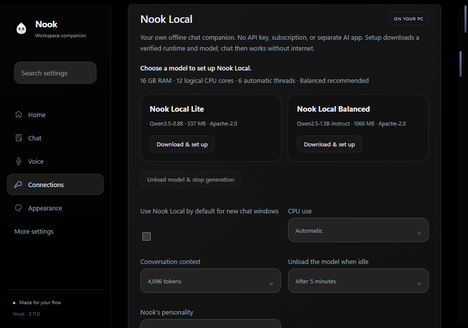

# Nook Local

Open **Connections → Nook Local** and choose **Download & set up**. Setup downloads
the CPU runtime and model once. Choose **Chat with this model** to open local chat.
No provider API key, subscription, or separate server application is needed.
You can make this the default provider for new chat windows.

- **Lite:** approximately 537 MiB, designed for lower memory use.
- **Balanced:** approximately 1,066 MiB, recommended for PCs with at least 12 GB RAM.
- Windows x64 and at least 4 GB of total RAM are required. Actual available memory
  and other applications affect whether a model can load. CPU inference is used;
  automatic thread selection leaves capacity for other work.

These are small Qwen models with Nook's personality instructions, rather than a
newly trained foundation model. They work best for short chats, rewriting, and
summaries. They can make mistakes. Selected Library document excerpts can be
attached; image input is currently unsupported. Long conversations or documents
may need a larger context setting or a shorter excerpt.

The engine starts on demand, listens only on 127.0.0.1, and uses a random private
session key. Chat never silently switches to a cloud provider. After setup, local
chat works offline. Online app actions still need their normal network access and
explicit review; connecting a local model does not grant extra action permissions.

CPU threads, context size, personality, and idle unloading are configurable.
These settings reduce resource use; they are not a hard Windows memory cap.
**Unload model & stop generation** stops the engine immediately. Lock, suspend,
and quitting Nook also stop it. The engine does not auto-start after resume.

Private memory is optional. Add up to twelve short notes under **Private memory**.
Only explicitly saved notes are included in local prompts, and they are encrypted
with Windows storage on disk. They are not supplied to cloud providers or used to
train weights. Clear memory explicitly to discard unreadable notes or reset it.
Normal chat-history saving remains governed by the existing separate settings.

Models and runtime are stored under Nook's user-data directory in `local-ai`.
Removing a model keeps chats and memory. Setup can retry interrupted downloads;
downloads restart from the beginning. SHA-256 verification is required before
installation and model startup. Model licenses and source attribution ship with
the application; see `lib/local-ai-NOTICE.md`.

Validation: `npm test` covers setup integrity and local routing without network.
`npm run smoke:local-ui` verifies app/notch integration with isolated fixtures.
`npm run smoke:local-ai` is an opt-in real CPU integration test: it downloads both
models into `dist/local-ai-real` and verifies streaming, memory, cancellation,
loopback authentication, and unloading without touching personal settings.
